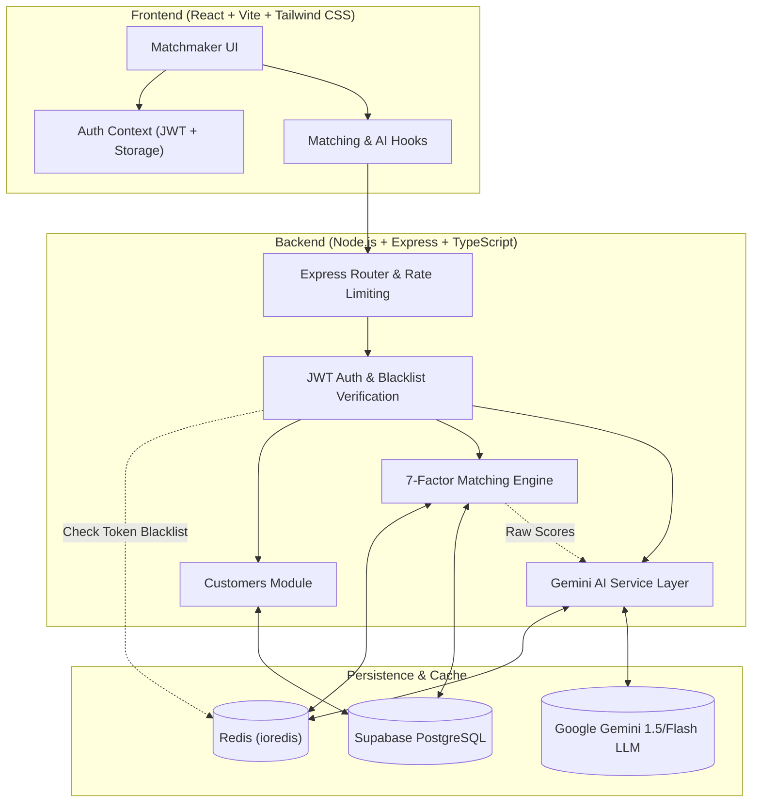

# TDC Matchmaker Dashboard & AI Matching Platform

A full-stack, enterprise-grade matchmaking CRM platform built for **The Date Crew (TDC)** matchmakers. The system equips professional matchmakers with an intelligent workspace to manage client biodatas, execute culturally informed 7-factor compatibility scoring, leverage Google Gemini LLM for nuanced match evaluations, generate personalized email pitches, and record match decisions in real time.

---

## Table of Contents

- [System Architecture](#system-architecture)
- [Key Features](#key-features)
- [Technology Stack & Rationale](#technology-stack--rationale)
- [Database Schema & Design](#database-schema--design)
- [Matching Algorithm Breakdown](#matching-algorithm-breakdown)
- [Gemini AI Integration & Resilience](#gemini-ai-integration--resilience)
- [Caching Strategy & Redis Architecture](#caching-strategy--redis-architecture)
- [API Reference](#api-reference)
- [Project Directory Structure](#project-directory-structure)
- [Local Setup & Getting Started](#local-setup--getting-started)
- [Demo Credentials & Testing](#demo-credentials--testing)

---

## System Architecture



---

## Key Features

### 1. Matchmaker Authentication & Workspace Security
- **Role-Gated Access**: Restricted to authenticated TDC matchmakers.
- **Secure Password Hashing**: Passwords stored using `bcryptjs` with 10 salt rounds.
- **Stateless JWT with Redis Blacklisting**: 7-day token expiration with immediate server-side revocation on logout via Redis `blacklist:<token>`.
- **Security Hardening**: `helmet` security headers, strict CORS with credential validation, and IP-based rate limiting via `express-rate-limit`.

### 2. Client Management & 360° Biodata View
- **Dashboard Grid & Filters**: Filter clients by status (`new`, `active`, `matched`, `paused`, `closed`), gender, and instant name/email search.
- **Deep Matrimonial Profiling**: Covers personal info, contact details, physical metrics, education, company/designation, income tier, religion, caste, languages, dietary preferences, drinking/smoking habits, relocation flexibility, kids preference, and pet friendliness.
- **Inline Status & Notes Editor**: Instant client status transitions with auto-saving notes persisted directly to Supabase.

### 3. Dual-Tier Matching Engine
- **Tier 1 (Algorithmic Heuristics)**: Gender-specific, culturally grounded scoring against active candidate pools (110+ verified profiles).
- **Tier 2 (AI Enrichment via Gemini)**: Normalized 0–100 compatibility scores, categorization labels (*"High Potential Match"*, *"Good Match"*, *"Possible Match"*), and two-sentence qualitative rationales.

### 4. Personalized AI Pitch & Match Delivery
- **Instant Pitch Generation**: Gemini creates warm, tailored 3–4 sentence introduction emails addressed directly to the client without exposing sensitive private metadata (e.g., exact salary, caste).
- **Send Match Workflow**: Modal preview with one-click dispatch, mock toast notification, and audit trail logged to `match_logs`.

---

## Technology Stack & Rationale

| Layer | Technology | Architectural Rationale |
|---|---|---|
| **Frontend Framework** | **React 18 + Vite** | Blazing-fast development server (ESM-based HMR), optimal production bundling, strict component lifecycle management. |
| **Language** | **TypeScript (v5.7 / v5.9)** | Unified end-to-end type safety across backend controllers, services, database models, and frontend interfaces. Prevents runtime property mismatch bugs. |
| **Styling & Design System** | **Tailwind CSS v4** | Modern utility-first engine with custom design tokens (`brand-dark`, `brand-surface`, `brand-pink`, `brand-purple`). Zero runtime overhead, predictable CSS output. |
| **Icons & UI Feedback** | **Lucide React & React Hot Toast** | Lightweight, accessible SVG icons and non-blocking, accessible toast notifications. |
| **API Communication** | **Axios with Interceptors** | Centralized client with authorization token injection, standard 45-second timeout for LLM streaming/generation, and automatic session expiration handling. |
| **Backend Runtime** | **Node.js + Express 5** | High-throughput asynchronous I/O, mature ecosystem, modular routing structure (`modules/auth`, `modules/customers`, `modules/matching`, `modules/ai`). |
| **Database** | **Supabase (PostgreSQL 15)** | Relational integrity with custom PostgreSQL enums, foreign key cascading, trigger-driven `updated_at` timestamps, and B-tree indexing on frequently searched fields. |
| **In-Memory Cache** | **Redis (ioredis)** | High-speed cache for precomputed match matrices, AI scores, generated email intros, and token blacklisting to reduce database and LLM API load. |
| **AI / Large Language Model** | **Google Gemini Flash (`@google/generative-ai`)** | High token throughput, cultural fluency in Indian matrimonial contexts, cost efficiency, and structured JSON parsing capabilities. |
| **Schema Validation** | **Zod** | Runtime request payload validation (UUID formats, customer status enums, notes limits) returning strict HTTP 422 errors on invalid inputs. |

---

## Database Schema & Design

The database consists of three core relational tables defined in `backend/supabase/migrations/`:

### 1. `matchmakers`
Represents TDC internal staff members who login to manage clients.
```sql
CREATE TABLE matchmakers (
  id            UUID PRIMARY KEY DEFAULT gen_random_uuid(),
  email         TEXT UNIQUE NOT NULL,
  name          TEXT NOT NULL,
  password_hash TEXT NOT NULL,
  is_active     BOOLEAN DEFAULT TRUE,
  created_at    TIMESTAMPTZ DEFAULT NOW(),
  updated_at    TIMESTAMPTZ DEFAULT NOW()
);
CREATE INDEX idx_matchmakers_email ON matchmakers(email);
```

### 2. `customers`
Stores client and candidate profiles with comprehensive demographic, professional, and matrimonial preferences.
```sql
CREATE TYPE customer_status AS ENUM ('new', 'active', 'matched', 'paused', 'closed');
CREATE TYPE gender_type AS ENUM ('male', 'female', 'other');
CREATE TYPE tristate AS ENUM ('yes', 'no', 'maybe');
CREATE TYPE marital_type AS ENUM ('single', 'divorced', 'widowed');
CREATE TYPE diet_type AS ENUM ('veg', 'non-veg', 'jain', 'vegan', 'eggetarian');
CREATE TYPE habit_type AS ENUM ('never', 'occasionally', 'socially', 'regularly');

CREATE TABLE customers (
  id                      UUID PRIMARY KEY DEFAULT gen_random_uuid(),
  assigned_matchmaker_id  UUID REFERENCES matchmakers(id) ON DELETE SET NULL,
  first_name              TEXT NOT NULL,
  last_name               TEXT NOT NULL,
  gender                  gender_type NOT NULL,
  date_of_birth           DATE NOT NULL,
  country                 TEXT NOT NULL DEFAULT 'India',
  city                    TEXT NOT NULL,
  height_cm               INTEGER NOT NULL,
  email                   TEXT UNIQUE NOT NULL,
  phone                   TEXT,
  college                 TEXT,
  degree                  TEXT,
  income_lpa              DECIMAL(10,2),
  company                 TEXT,
  designation             TEXT,
  marital_status          marital_type NOT NULL DEFAULT 'single',
  languages               TEXT[] DEFAULT '{}',
  siblings                INTEGER DEFAULT 0,
  caste                   TEXT,
  religion                TEXT,
  want_kids               tristate DEFAULT 'maybe',
  open_to_relocate        tristate DEFAULT 'maybe',
  open_to_pets            tristate DEFAULT 'maybe',
  dietary_preference      diet_type DEFAULT 'veg',
  drinking                habit_type DEFAULT 'never',
  smoking                 habit_type DEFAULT 'never',
  hobbies                 TEXT[] DEFAULT '{}',
  profile_photo_url       TEXT,
  status_tag              customer_status DEFAULT 'new',
  notes                   TEXT,
  is_dummy                BOOLEAN DEFAULT FALSE,
  created_at              TIMESTAMPTZ DEFAULT NOW(),
  updated_at              TIMESTAMPTZ DEFAULT NOW()
);

CREATE INDEX idx_customers_matchmaker ON customers(assigned_matchmaker_id);
CREATE INDEX idx_customers_gender ON customers(gender);
CREATE INDEX idx_customers_status ON customers(status_tag);
CREATE INDEX idx_customers_city ON customers(city);
```

### 3. `match_logs`
Audit log tracking every match dispatched by a matchmaker.
```sql
CREATE TABLE match_logs (
  id                UUID PRIMARY KEY DEFAULT gen_random_uuid(),
  customer_id       UUID NOT NULL REFERENCES customers(id) ON DELETE CASCADE,
  matched_with_id   UUID NOT NULL REFERENCES customers(id) ON DELETE CASCADE,
  matchmaker_id     UUID NOT NULL REFERENCES matchmakers(id) ON DELETE CASCADE,
  ai_score          INTEGER,
  ai_explanation    TEXT,
  ai_intro          TEXT,
  action            TEXT DEFAULT 'sent',
  created_at        TIMESTAMPTZ DEFAULT NOW()
);
CREATE INDEX idx_match_logs_customer ON match_logs(customer_id);
CREATE INDEX idx_match_logs_matchmaker ON match_logs(matchmaker_id);
```

---

## Matching Algorithm Breakdown

The matching engine in `matching.algorithm.ts` is divided into gender-specific heuristics modeled after traditional and contemporary Indian matrimonial dynamics:

### Scoring Factors Comparison

| Factor | Male Client Evaluating Female Candidate | Female Client Evaluating Male Candidate | Rationale |
|---|---|---|---|
| **Age Compatibility** | **Max 25 pts**<br>• 1–5 yrs younger: 25 pts<br>• 0–1 yrs younger: 18 pts<br>• 5–8 yrs younger: 12 pts<br>• 0–2 yrs older: 8 pts | **Max 20 pts**<br>• 2–5 yrs older: 20 pts<br>• 0–2 yrs older: 15 pts<br>• 5–8 yrs older: 12 pts<br>• 0–1 yrs younger: 8 pts | Reflects prevalent matrimonial age preferences in India while accommodating near-peer age parity. |
| **Height Compatibility** | **Max 15 pts**<br>• ≥5 cm shorter: 15 pts<br>• 0–5 cm shorter: 10 pts<br>• up to 3 cm taller: 5 pts | **Max 10 pts**<br>• ≥5 cm taller: 10 pts<br>• 0–5 cm taller: 7 pts<br>• up to 3 cm shorter: 3 pts | Matches expectations regarding height hierarchy. |
| **Income Relationship** | **Max 15 pts**<br>• Candidate earns <50%: 15 pts<br>• 50–75%: 12 pts<br>• 75–100%: 8 pts<br>• 100–120%: 5 pts | **Max 20 pts**<br>• Candidate earns ≥150%: 20 pts<br>• 100–150%: 15 pts<br>• 80–100%: 10 pts | Women frequently prioritize financial security/parity; men traditionally prioritize parity or earning more. |
| **Children Alignment** | **Max 20 pts**<br>• Exact match: 20 pts<br>• 'maybe' compromise: 10 pts<br>• Hard mismatch (yes/no): 0 pts | **Max 20 pts**<br>• Exact match: 20 pts<br>• 'maybe' compromise: 10 pts<br>• Hard mismatch (yes/no): 0 pts | Critical long-term dealbreaker; zero tolerance for direct yes-vs-no conflict. |
| **Relocation Willingness** | **Max 10 pts**<br>• Exact match: 10 pts<br>• 'maybe': 5 pts | **Max 15 pts**<br>• Exact match: 15 pts<br>• 'maybe': 7.5 pts | Weighted higher for female clients as career mobility and relocation are crucial considerations. |
| **Religion Compatibility** | **Max 10 pts**<br>• Shared religion: 10 pts | **Max 5 pts**<br>• Shared religion: 5 pts | Evaluates community harmony; caste is omitted from scoring for ethical and human evaluation. |
| **Language Overlap** | **Max 5 pts**<br>• 2.5 pts per shared language | **Max 5 pts**<br>• 2.5 pts per shared language | Shared mother tongue/languages foster natural family bonding. |
| **Dietary Compatibility** | **Max 5 pts**<br>• Exact match: 5 pts<br>• Veg + Jain: 3 pts | **Max 5 pts**<br>• Exact match: 5 pts<br>• Veg + Veg: 5 pts | Dietary compatibility is a foundational everyday lifestyle factor. |
| **Marital Status** | **Max 5 pts**<br>• Both single: 5 pts<br>• Matching status: 3 pts | **Max 5 pts**<br>• Matching status: 5 pts | Parity in prior marital history. |
| **Shared Hobbies** | **Max 5 pts**<br>• 2 pts per overlapping hobby | **Max 5 pts**<br>• 2 pts per overlapping hobby | Quality-of-life and leisure connection bonus. |
| **Maximum Possible Score** | **115 points** | **110 points** | Raw score sorted descending; top 15 returned. |

---

## Gemini AI Integration & Resilience

### 1. Dual AI Endpoints
- **Batch Evaluation (`GET /api/ai/:customerId/ai-matches`)**: Evaluates top algorithm candidates, generating a normalized 0–100 score, categorization label, and two-sentence qualitative assessment.
- **Personalized Intro Email (`POST /api/ai/:customerId/intro`)**: Drafts a warm, professional matrimonial pitch tailored specifically to the client.

### 2. High-Availability Fallback Mechanism
If the Google Gemini API experiences transient spikes (such as HTTP 503 Service Unavailable or rate limits):
1. The backend catches the exception without failing the user request.
2. It automatically calculates normalized algorithmic scores scaled to 0–100:
   $$\text{aiScore} = \text{round}\left(\frac{\text{rawScore}}{\text{maxRaw}} \times 100\right)$$
3. Assigns standardized labels based on thresholds:
   - **80–100**: 🔥 *High Potential Match*
   - **60–79**: ✨ *Good Match*
   - **40–59**: 💫 *Possible Match*
4. Provides a fallback introduction template with candidate designation and city, ensuring 100% platform uptime.

---

## Caching Strategy & Redis Architecture

To ensure sub-10ms response times and protect LLM token quotas, the application uses an in-memory Redis caching layer:

```
┌─────────────────────────────────┬──────────┬────────────────────────────────────────────────────────┐
│ Cache Key Pattern               │ TTL      │ Stored Data                                            │
├─────────────────────────────────┼──────────┼────────────────────────────────────────────────────────┤
│ matches:<customerId>            │ 24 Hours │ Pre-scored top 15 candidate profiles with breakdowns   │
│ ai-scores:<customerId>          │ 6 Hours  │ LLM compatibility scores, labels, and explanations     │
│ intro:<clientId>:<candidateId>  │ 24 Hours │ Generated personalized email intro text                │
│ blacklist:<jwtToken>            │ ExpireIn │ Revoked JWT tokens on matchmaker logout                │
└─────────────────────────────────┴──────────┴────────────────────────────────────────────────────────┘
```

- **Cache Invalidation**: Calling `invalidateMatchCache(customerId)` removes cached results when client preferences are updated.
- **Fail-Safe Design**: If Redis is momentarily unreachable, all operations fail open and fall back to direct database execution.

---

## API Reference

### Authentication (`/api/auth`)
| Method | Endpoint | Description | Auth Required |
|---|---|---|:---:|
| `POST` | `/api/auth/login` | Authenticate matchmaker, returns JWT token & user profile | No |
| `POST` | `/api/auth/logout` | Invalidate current JWT token by adding it to Redis blacklist | Yes |
| `GET` | `/api/auth/me` | Fetch currently authenticated matchmaker profile | Yes |

### Customers (`/api/customers`)
| Method | Endpoint | Description | Auth Required |
|---|---|---|:---:|
| `GET` | `/api/customers` | List assigned customers with search, status, gender & pagination | Yes |
| `GET` | `/api/customers/:id` | Retrieve full 360° biodata for a specific customer | Yes |
| `PATCH`| `/api/customers/:id` | Update customer `status_tag` or append/edit `notes` | Yes |

### Matching Engine (`/api/matching`)
| Method | Endpoint | Description | Auth Required |
|---|---|---|:---:|
| `GET` | `/api/matching/:customerId/matches` | Calculate top 15 algorithmic matches using 7-factor engine | Yes |
| `POST` | `/api/matching/:customerId/log` | Record sent match action into `match_logs` audit table | Yes |

### AI Integration (`/api/ai`)
| Method | Endpoint | Description | Auth Required |
|---|---|---|:---:|
| `GET` | `/api/ai/:customerId/ai-matches` | Run 7-factor algorithm + Gemini compatibility evaluation | Yes |
| `POST` | `/api/ai/:customerId/intro` | Generate personalized introduction email for a match pair | Yes |

---

## Project Directory Structure

```
.
├── backend/
│   ├── scripts/
│   │   └── generate-seed.ts            # Synthetic data generation (110+ dummy candidates)
│   ├── src/
│   │   ├── app.ts                      # Express app initialization, CORS, middlewares & routing
│   │   ├── modules/
│   │   │   ├── ai/
│   │   │   │   ├── ai.controller.ts    # AI scoring and intro endpoints
│   │   │   │   ├── ai.routes.ts        # Route declarations for /api/ai
│   │   │   │   └── ai.service.ts       # Gemini Flash API integration & fallback logic
│   │   │   ├── auth/
│   │   │   │   ├── auth.controller.ts  # Login, logout, session check handlers
│   │   │   │   ├── auth.routes.ts      # Route declarations for /api/auth
│   │   │   │   └── auth.service.ts     # Password verification & token issuance
│   │   │   ├── customers/
│   │   │   │   ├── customers.controller.ts # Customer CRUD & filtering
│   │   │   │   ├── customers.routes.ts     # Route declarations for /api/customers
│   │   │   │   └── customers.service.ts    # Supabase queries & matching pool fetch
│   │   │   └── matching/
│   │   │       ├── matching.algorithm.ts   # Gender-specific 7-factor scoring engine
│   │   │       ├── matching.controller.ts  # Match results handler & logging
│   │   │       ├── matching.routes.ts      # Route declarations for /api/matching
│   │   │       └── matching.service.ts     # Pool execution & Redis caching
│   │   ├── shared/
│   │   │   ├── config/
│   │   │   │   ├── redis.ts            # ioredis client setup & reconnection logic
│   │   │   │   └── supabase.ts         # Supabase client initialization
│   │   │   ├── middlewares/
│   │   │   │   ├── auth.middleware.ts  # JWT verification & blacklist checking
│   │   │   │   ├── error.middleware.ts # Global exception handler
│   │   │   │   └── rateLimiter.middleware.ts # IP-based API rate limiting
│   │   │   └── utils/
│   │   │       ├── hash.util.ts        # bcrypt comparison helper
│   │   │       ├── jwt.util.ts         # JWT signing & verification
│   │   │       └── response.util.ts    # Unified JSON response helpers
│   │   └── types/
│   │       └── index.ts                # TypeScript domain models & API response interfaces
│   ├── supabase/
│   │   └── migrations/                 # PostgreSQL migrations (001 to 004)
│   ├── package.json
│   └── tsconfig.json
│
├── frontend/
│   ├── src/
│   │   ├── App.tsx                     # Top-level Router & route declarations
│   │   ├── main.tsx                    # React DOM entrypoint with AuthProvider
│   │   ├── index.css                   # Tailwind CSS v4 design tokens & base typography
│   │   ├── modules/
│   │   │   ├── auth/
│   │   │   │   ├── context/AuthContext.tsx # React Auth state, login/logout functions
│   │   │   │   ├── hooks/useLogin.ts       # Login mutation hook
│   │   │   │   └── pages/LoginPage.tsx     # Modern branded login view
│   │   │   ├── customers/
│   │   │   │   ├── components/
│   │   │   │   │   ├── BiodataPanel.tsx    # Comprehensive client profile display
│   │   │   │   │   └── NotesEditor.tsx     # Matchmaker notes textarea with save status
│   │   │   │   ├── hooks/
│   │   │   │   │   ├── useCustomer.ts      # Single customer fetch & mutation hook
│   │   │   │   │   └── useCustomers.ts     # Customer list fetch with filters
│   │   │   │   └── pages/CustomerDetailPage.tsx # Main client view layout
│   │   │   ├── dashboard/
│   │   │   │   ├── components/CustomerCard.tsx # Card preview for dashboard grid
│   │   │   │   └── pages/DashboardPage.tsx     # Dashboard grid with search & filters
│   │   │   └── matching/
│   │   │       ├── components/
│   │   │       │   ├── MatchCard.tsx       # Scored candidate card with tags & action
│   │   │       │   ├── MatchSection.tsx    # Match execution trigger & results list
│   │   │       │   └── SendMatchModal.tsx  # Intro email preview & dispatch modal
│   │   │       └── hooks/
│   │   │           ├── useMatches.ts       # Hook fetching matches from API
│   │   │           └── useMatchLog.ts      # Match dispatch logger
│   │   ├── shared/
│   │   │   ├── api/client.ts           # Axios instance with interceptors & 45s timeout
│   │   │   ├── components/             # Reusable UI primitives (Button, Card, Modal, etc.)
│   │   │   └── utils/format.ts         # Age, height, currency & date formatting helpers
│   │   └── types/index.ts              # Frontend domain models matching backend contracts
│   ├── package.json
│   ├── vite.config.ts
│   └── tsconfig.json
│
└── README.md
```

---

## Local Setup & Getting Started

### 1. Prerequisites
- **Node.js**: v20.x or higher
- **npm**: v10.x or higher
- **Redis Server**: Running locally on `localhost:6379` or an Upstash Redis URL
- **Supabase Project**: Free-tier cloud instance or local Supabase Docker instance
- **Google Gemini API Key**: Acquired from [Google AI Studio](https://aistudio.google.com/app/apikey)

### 2. Environment Configuration

#### Backend Configuration (`backend/.env`)
Create `backend/.env` based on `backend/.env.example`:
```env
PORT=5000
NODE_ENV=development
SUPABASE_URL=https://your-project-id.supabase.co
SUPABASE_SERVICE_ROLE_KEY=your-supabase-service-role-key
REDIS_URL=redis://localhost:6379
JWT_SECRET=your-32-char-random-secret-key-here
JWT_EXPIRES_IN=7d
GEMINI_API_KEY=your-gemini-api-key
GEMINI_MODEL=gemini-flash-latest
FRONTEND_URL=http://localhost:5173
```

#### Frontend Configuration (`frontend/.env`)
Create `frontend/.env` based on `frontend/.env.example`:
```env
VITE_API_BASE_URL=http://localhost:5000/api
VITE_APP_NAME="The Date Crew — Matchmaker Dashboard"
```

### 3. Database Migration & Seeding

1. Apply the SQL migrations located in `backend/supabase/migrations/` sequentially in your Supabase SQL Editor:
   - `001_create_matchmakers.sql`
   - `002_create_customers.sql`
   - `003_create_match_logs.sql`
   - `004_seed_matchmaker.sql`
2. Run the synthetic data generator to seed assigned clients and 110 dummy candidates:
   ```bash
   cd backend
   npx ts-node scripts/generate-seed.ts
   ```

### 4. Running the Development Servers

#### Start Backend
```bash
cd backend
npm install
npm run dev
# Server starts on http://localhost:5000
```

#### Start Frontend
```bash
cd frontend
npm install
npm run dev
# Application starts on http://localhost:5173
```

---

## Demo Credentials & Testing

| Matchmaker Account | Email | Password | Role |
|---|---|---|---|
| **Priya Sharma** | `demo@thedatecrew.com` | `password123` | Senior Matchmaker |
| **Arjun Kapoor** | `arjun@thedatecrew.com` | `password123` | Matchmaker |

### Testing Workflow:
1. Navigate to `http://localhost:5173/login` and log in with the demo credentials above.
2. From the **Dashboard**, select a customer profile (e.g., *Kabir*, *Tanya*, or *Sneha*).
3. Review their complete matrimonial biodata, physical attributes, lifestyle preferences, and matchmaker notes.
4. On the right column, click **"Compute Algorithmic Matches"**.
5. Observe the live compatibility scoring, score badges (🔥, ✨, 💫), and AI rationales.
6. Click **"Send Match"** on any candidate card to preview the personalized introduction email written by Gemini AI, and dispatch the suggestion with instant feedback.
